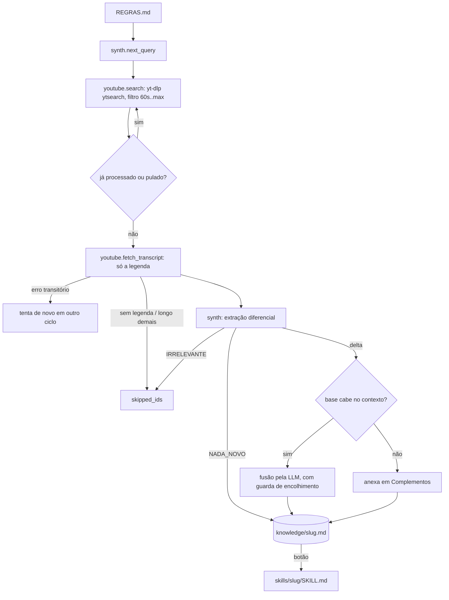

# Arquitetura

## Módulos

| Módulo | Responsabilidade |
| --- | --- |
| `bin/cli.js` | Launcher do `npx`: acha Python 3.11+, cria o venv em `<data-dir>/venv`, instala `requirements.txt` quando o hash muda e roda `python -m ytkb`. Sem dependências npm, sem `postinstall`, nunca usa shell. |
| `ytkb/__main__.py` | Argumentos, pasta de dados, sobe o servidor e abre o navegador. |
| `ytkb/paths.py` | Layout da pasta de dados e `safe_join()`, que impede qualquer caminho de sair dela. |
| `ytkb/rules.py` | Lê e grava `REGRAS.md` (assunto, duração máxima, diretrizes). Toda validação de entrada das regras mora aqui. |
| `ytkb/youtube.py` | yt-dlp como biblioteca: busca, escolha de legenda e parser WebVTT. |
| `ytkb/llm.py` | Cliente mínimo da API `/api/generate` do Ollama, normalização de `OLLAMA_HOST`, escolha de modelo. |
| `ytkb/synth.py` | Prompts (base inicial, delta, fusão, skill, nova busca), orçamento de contexto e `lint_skill()`. |
| `ytkb/agent.py` | Estado (`state.json`), loop autônomo, fila de links manuais e geração de skill. |
| `ytkb/server.py` | HTTP local com validação de Host, Origin, Content-Type e tamanho do corpo. |
| `ytkb/web/` | Painel (HTML + `app.js`) e bibliotecas vendorizadas (marked, DOMPurify). |

## Fluxo de um ciclo

## Concorrência

- `Agent._lock` (RLock) protege o estado em memória e toda gravação de `state.json`. O painel lê uma cópia (`deepcopy`) feita sob o lock.
- `Agent._job_lock` garante uma tarefa pesada por vez (vídeo do loop, link manual ou skill). Evita duas inferências simultâneas no Ollama e escrita concorrente na mesma base.
- Links manuais entram numa fila (`MAX_PENDING_URLS = 10`, sem duplicatas) consumida por uma única thread.
- `stop()` sinaliza o loop; a tarefa em andamento termina antes. Enquanto isso o painel mostra "Parando..." e `start()` responde 409.
- Gravações de base, skill e estado são atômicas (arquivo temporário + `os.replace`). Um `state.json` corrompido é renomeado para `state.json.corrupt-<timestamp>` e o erro vai para o log, em vez de zerar o histórico em silêncio.

## Orçamento de contexto

Os limites saem de `OLLAMA_NUM_CTX` (padrão 16384 tokens), estimando 3 caracteres por token:

| Prompt | Limite |
| --- | --- |
| Transcrição compactada | 38% do contexto |
| Base no prompt de delta | 38% do contexto |
| Base na fusão | 40% do contexto (a base entra e sai inteira) |
| Base na geração de skill | 50% do contexto |

Quando a base passa do limite de fusão, o agente para de reescrevê-la e anexa os complementos numa seção própria. Assim a LLM nunca recebe uma base truncada que devolveria sem o final.

## Modelo de ameaça

| Ameaça | Mitigação |
| --- | --- |
| Site malicioso chamando a API local (CSRF) | POST exige `Content-Type: application/json` (força preflight CORS, que nunca é aprovado) e `Origin` igual ao do painel |
| DNS rebinding | `Host` precisa ser `127.0.0.1:<porta>` ou `localhost:<porta>` |
| XSS via Markdown gerado de transcrições | DOMPurify em todo HTML, CSP `script-src 'self'`, nenhum handler inline, escape de atributos |
| Prompt injection nas transcrições | Delimitadores `<transcricao>`/`<base>` que não podem ser fechados pelo conteúdo, regra explícita no system prompt |
| Skill maliciosa executada por outro agente | Frontmatter montado em Python, aviso de revisão obrigatório, `lint_skill()` lista trechos suspeitos, nada é instalado automaticamente |
| Path traversal | `slugify()` + `safe_join()` em todo caminho derivado de entrada; arquivos estáticos servidos por lista fixa |
| Corpo gigante ou JSON inválido | Limite de 1 MB, respostas 400/413/415 em JSON |
| Porta sequestrada no Windows | `allow_reuse_address` desligado no Windows |
| Supply chain | Dependências Python com versão exata, JS vendorizado com versão fixa, pacote npm sem scripts de instalação e publicado com provenance |

Fora do escopo: outro processo local malicioso rodando como o mesmo usuário (ele já tem acesso aos seus arquivos).
